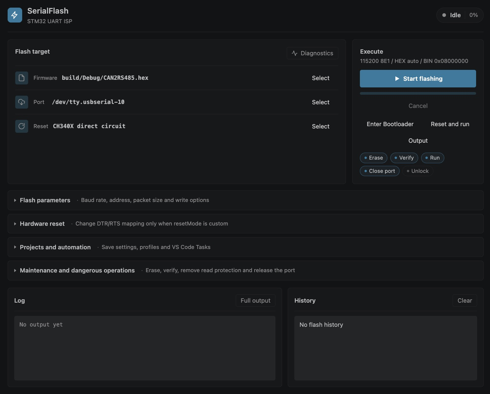

# STM32 Serial Flasher

[](https://marketplace.visualstudio.com/items?itemName=totok22.serialflash-stm32)
[](LICENSE)

STM32 Serial Flasher is a VS Code extension for programming STM32 microcontrollers with `.hex` and `.bin` firmware through the chip's built-in ROM USART bootloader.

Paired with a USB-UART bridge and an auto-reset circuit, a single USB-C cable handles the entire workflow directly inside VS Code: bootloader entry, chip erase, programming, verification, and reset-to-run. No ST-Link or external flashing utility is required.

[简体中文](README.zh-CN.md) · [Usage Reference](docs/USAGE.en.md) · [Hardware Notes](docs/CH340_HARDWARE.en.md) · [Contributing](CONTRIBUTING.en.md)

---

## Features

- **Multiple Interfaces**: Interactive Webview panel, Activity Bar sidebar, Command Palette, editor context menus, and status bar integration.
- **Automatic Firmware Discovery**: Scans workspace build folders, filters out compiler probe artifacts (such as `CMakeFiles`), and parses Intel HEX base addresses or raw binaries.
- **Hardware Reset Modes**: Built-in presets for CH340C and CH340X auto-download circuits, manual bootloader entry, and configurable DTR/RTS pin mappings.
- **State Persistence & Profiles**: Remembers last-used serial settings; supports named project profiles for different boards and build targets.
- **VS Code Tasks Integration**: Contributes a task provider to chain build and flash steps into a single automated workflow.
- **Diagnostics & Output Logs**: Integrated diagnostics for serial enumeration and extension host status, complete with detailed operation logs.

---

## Installation

Install **STM32 Serial Flasher** from the [VS Code Marketplace](https://marketplace.visualstudio.com/items?itemName=totok22.serialflash-stm32), or via terminal:

```bash
code --install-extension totok22.serialflash-stm32
```

> [!NOTE]
> The published Marketplace release is **0.2.1**. The bilingual panel and expanded documentation are documented in [CHANGELOG.md](CHANGELOG.md). For local builds and debugging, see [CONTRIBUTING.en.md](CONTRIBUTING.en.md).

---

## Panel Preview



*The panel language adapts automatically to the VS Code display language (English and Chinese supported).*

---

## Quick Start

1. **Build Firmware**: Open your firmware project in VS Code and build your `.hex` or `.bin` binary.
2. **Connect Device**: Plug your board into the computer and ensure no other terminal or monitor is holding the serial port.
3. **Open Panel**: Click the SerialFlash icon in the Activity Bar or run `SerialFlash: Open Flasher Panel`.
4. **Configure**: Select the serial port, firmware file, and reset mode matching your circuit.
5. **Flash**: Click **Flash** or press `Cmd+Alt+F` (macOS) / `Ctrl+Alt+F` (Windows/Linux).
6. **Inspect Log**: Check the Output channel for bootloader version, PID, erase, write, and verification status.

---

## Wiring & Reset Modes

Ensure the MCU breaks out the USART pins supported by its system ROM bootloader (refer to ST [AN2606](https://www.st.com/resource/en/application_note/an2606-stm32-microcontroller-system-memory-boot-mode-stmicroelectronics.pdf)). Connect USB-UART TX to MCU RX, RX to MCU TX, and share a common ground.

| Reset Mode | Description |
| --- | --- |
| `dtr-low-rts-high` | **CH340C classic circuit** (transistor-based BOOT0/RESET control; default) |
| `ch340x` | **CH340X direct circuit** (using RTS# and enhanced DTR control lines) |
| `none` | **Manual mode** (toggle BOOT0 and reset buttons manually; DTR/RTS lines idle) |
| `dtr-high-rts-low` | **Generic reversed preset** (DTR high asserts reset, RTS low sets boot) |
| `custom` | **Custom mode** (manually configure DTR/RTS assert/deassert states) |

For complete schematics, logic levels, and reset timing, see [Hardware Notes](docs/CH340_HARDWARE.en.md).

---

## Firmware & Flash Addresses

- **Selection Priority**: If a configured firmware path (or previously remembered path) exists, it takes precedence. Otherwise, when `autoDiscoverFirmware` is enabled, the workspace is scanned for candidates.
- **Default Flash Address**:

| Format | Default Address | Note |
| --- | --- | --- |
| Intel HEX (`.hex`) | Base address in file | Parsed from the extended linear address record |
| Raw Binary (`.bin`) | `0x08000000` | Default STM32 internal flash start address |

An explicit `serialFlash.flashAddress` setting overrides both defaults. For all configuration options, see the [Usage Reference](docs/USAGE.en.md).

---

## Runtime Environments

- **Supported Hosts**: VS Code Desktop 1.90+ on macOS, Windows, and Linux.
- **Port Visibility**: Serial communication runs in the extension host. In Remote SSH, WSL, or Dev Containers, serial ports belong to the machine hosting the extension. Run `SerialFlash: Run Diagnostics` to inspect the environment.
- **Unsupported**: Browser-based editors (`vscode.dev`, `github.dev`) lack native serial access and cannot run flashing workflows.

---

## Documentation Index

- [Usage Reference](docs/USAGE.en.md): Complete command list, configuration options, named profiles, tasks, and troubleshooting.
- [Hardware Notes](docs/CH340_HARDWARE.en.md): CH340C/CH340X schematics, control polarity conventions, and reset timing.
- [Protocol Reference](docs/STM32_PROTOCOL.en.md): STM32 USART ISP bootloader packet format and supported commands.
- [Hardware Validation](docs/HARDWARE_VALIDATION.md): Physical hardware test criteria and report template.
- [Contributing](CONTRIBUTING.en.md): Setting up local development, F5 debugging, and VSIX packaging.
- [Changelog](CHANGELOG.md): Release history and upcoming features.

---

## License

[MIT](LICENSE)
