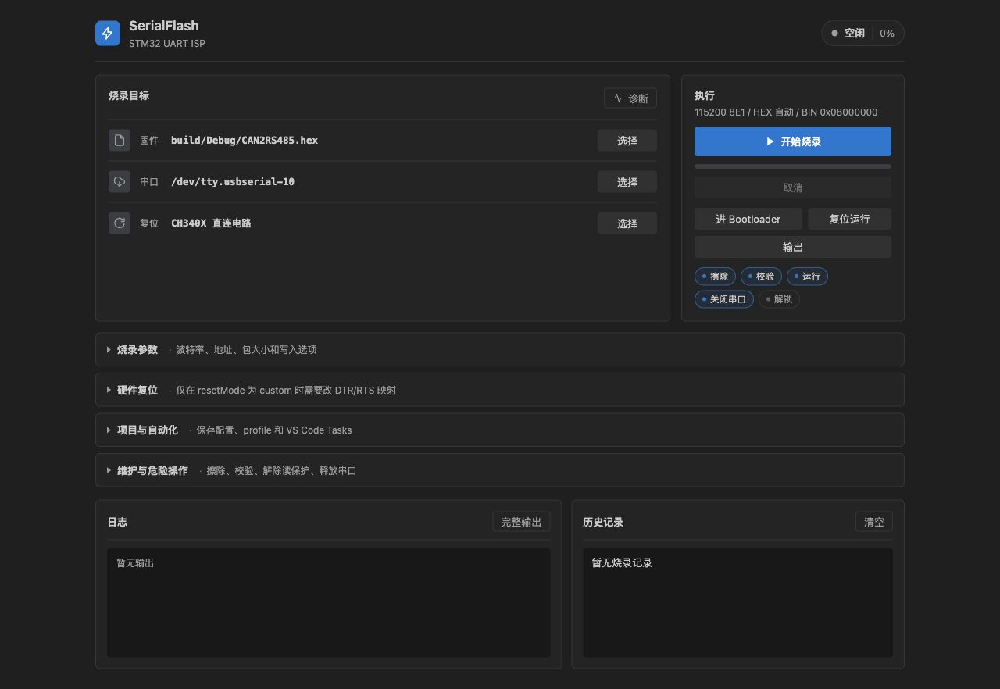

# STM32 Serial Flasher

[](https://marketplace.visualstudio.com/items?itemName=totok22.serialflash-stm32)
[](LICENSE)

STM32 Serial Flasher 是一款适用于 VS Code 的固件烧录扩展，通过芯片内置的 ROM USART Bootloader 烧录 `.hex` 与 `.bin` 固件。

搭配板载 USB-UART 桥接芯片与自动复位电路，只需一根 USB-C 数据线即可在 VS Code 内完成进入 Bootloader、擦除、写入、校验及复位运行的完整流程，无需依赖 ST-Link 或第三方独立烧录工具。

[English](README.md) · [使用手册](docs/USAGE.md) · [硬件说明](docs/CH340_HARDWARE.md) · [参与开发](CONTRIBUTING.md)

---

## 核心特性

- **多交互入口**：支持图形化控制面板（Webview）、Activity Bar 侧边栏、命令面板、文件右键菜单及状态栏快捷操作。
- **固件自动发现**：检索工作区构建输出，自动排除编译器探测产物（如 `CMakeFiles`），支持 Intel HEX 基地址解析与 BIN 格式。
- **灵活的硬件复位**：内置 CH340C、CH340X 经典自动下载时序预设，支持纯手动模式与自定义 DTR/RTS 控制线映射。
- **配置记忆与多 Profile**：自动记住成功烧录参数，支持通过命名配置（Profile）管理不同板卡与构建目标。
- **VS Code Tasks 集成**：提供 Task Provider，可直接与编译任务串联，按顺序自动完成构建与烧录。
- **诊断与完整日志**：内置串口枚举与扩展宿主环境诊断工具，提供实时操作日志与排查指引。

---

## 安装

在 VS Code 扩展市场搜索并安装 `STM32 Serial Flasher`（扩展 ID：`totok22.serialflash-stm32`），或通过终端安装：

```bash
code --install-extension totok22.serialflash-stm32
```

> [!NOTE]
> 当前市场已发布版本为 **0.2.1**。双语面板与文档更新见 [CHANGELOG.md](CHANGELOG.md)。本地开发与调试请参考 [CONTRIBUTING.md](CONTRIBUTING.md)。

---

## 面板预览



*面板语言跟随 VS Code 界面语言自动切换（支持中文与英文）。*

---

## 快速上手

1. **准备固件**：在 VS Code 中打开固件工程，并确保已编译生成 `.hex` 或 `.bin` 文件。
2. **连接设备**：将开发板通过 USB 连接至电脑，确保无其他串口助手或监视器占用该端口。
3. **打开面板**：点击 Activity Bar 侧边栏的 SerialFlash 图标，或执行命令 `SerialFlash: Open Flasher Panel`。
4. **选择参数**：选择目标串口、固件文件，以及匹配板载电路的复位模式。
5. **开始烧录**：点击 **Flash** 按钮，或使用快捷键 `Cmd+Alt+F`（macOS）/ `Ctrl+Alt+F`（Windows/Linux）。
6. **查看结果**：在 Output 通道中查看握手信息、Bootloader 版本、PID 与擦写校验日志。

---

## 接线与复位模式

MCU 需引出其系统 ROM Bootloader 支持的 USART 引脚（详见 ST [AN2606](https://www.st.com/resource/en/application_note/an2606-stm32-microcontroller-system-memory-boot-mode-stmicroelectronics.pdf)）。USB-UART 模块的 TX 接 MCU Bootloader RX，RX 接 MCU TX，并确保共地。

| 复位模式 | 适用场景 |
| --- | --- |
| `dtr-low-rts-high` | **CH340C 经典外围电路**（三极管控制 BOOT0/RESET，扩展默认） |
| `ch340x` | **CH340X 直连电路**（利用 RTS# 与增强 DTR 控制线） |
| `none` | **手动模式**（通过板载按键或跳线手动拉高 BOOT0 并复位，扩展不控制 DTR/RTS） |
| `dtr-high-rts-low` | **通用反向模式**（DTR 高电平复位，RTS 低电平进入 BOOT） |
| `custom` | **自定义模式**（手动指定 DTR 与 RTS 的高低电平映射） |

完整原理图解析、极性约定与时序细节请参阅 [CH340 硬件说明](docs/CH340_HARDWARE.md)。

---

## 固件与烧录地址

- **固件选择优先级**：若已配置固件路径（或上次成功烧录的固件）仍然存在，则直接使用；若不存在，且开启了 `autoDiscoverFirmware`，插件将自动检索工作区内最新的固件。
- **烧录基地址规则**：

| 固件格式 | 默认烧录地址 | 说明 |
| --- | --- | --- |
| Intel HEX (`.hex`) | 文件内记录的数据基地址 | 自动解析 HEX 头部中的起始偏移 |
| 原始二进制 (`.bin`) | `0x08000000` | STM32 片内 Flash 默认起始地址 |

在设置中显式配置 `serialFlash.flashAddress` 可覆盖上述默认值。详细配置项见 [使用手册](docs/USAGE.md)。

---

## 运行环境

- **支持宿主**：VS Code Desktop 1.90+（macOS、Windows、Linux）。
- **串口归属**：原生串口访问运行于 VS Code 本地扩展宿主。在 Remote SSH、WSL 或 Dev Container 环境下，串口枚举属于运行扩展的远端机器。可通过 `SerialFlash: Run Diagnostics` 检查当前环境。
- **不支持环境**：纯浏览器环境（如 `vscode.dev`、`github.dev`）缺少 Node.js 底层硬件接口，不支持串口烧录。

---

## 文档索引

- [使用手册](docs/USAGE.md)：命令列表、详细配置项、Profile 多项目配置、Tasks 任务链与排查指南。
- [硬件说明](docs/CH340_HARDWARE.md)：CH340C/CH340X 电路图、控制线极性约定与硬件复位时序。
- [协议说明](docs/STM32_PROTOCOL.md)：STM32 USART ISP Bootloader 通信协议与指令子集。
- [硬件验证模板](docs/HARDWARE_VALIDATION.md)：实机回归测试规范与记录表。
- [参与开发](CONTRIBUTING.md)：本地开发环境搭建、F5 调试与 VSIX 打包测试。
- [变更记录](CHANGELOG.md)：版本发布历史与待发布特性。

---

## 许可证

[MIT](LICENSE)
