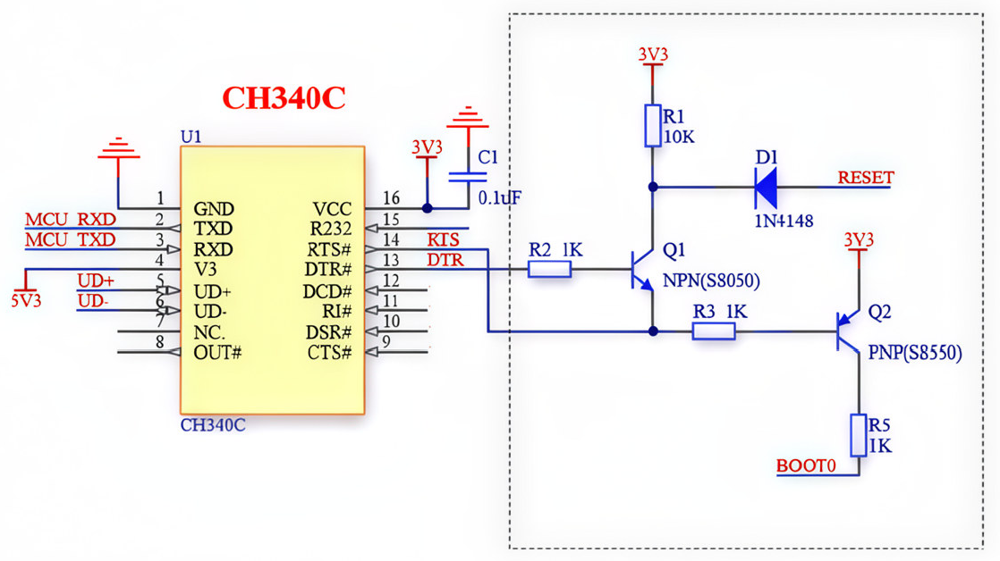
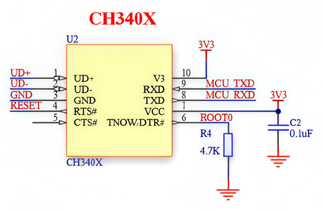

# CH340 Hardware & Reset Timing Reference

[简体中文](CH340_HARDWARE.md)

This document describes the circuit topology, signal polarity conventions, and reset timing for automatic download circuits based on CH340-series USB-UART bridges.

0.2.2 pre-release changes have partial hardware validation on the CH340C PDM board; see the [validation record](HARDWARE_VALIDATION.md#3-2026-11-08ch340c-pdm-验证). Current CH340X, Windows, and Linux regressions remain pending.

---

## 1. Hardware Connection Requirements

STM32 microcontrollers execute ISP flashing via their built-in system ROM USART bootloader. Connecting a target board with a USB-UART bridge requires:

- **Serial Lines**: USB-UART TXD connects to STM32 Bootloader USART RX, and RXD connects to TX. Both sides share a common ground (GND).
- **Logic Voltage**: Verify the USB-UART I/O logic level matches the MCU voltage (typically 3.3V). Do not connect 5V or RS-232 levels directly to STM32 I/O pins.
- **Bootloader & Reset Pins**: The auto-download circuit controls STM32 BOOT0 (or designated boot configuration pins) and NRST via the bridge's DTR/RTS lines. BOOT1 (if present) is typically tied to GND. Refer to ST [AN2606](https://www.st.com/resource/en/application_note/an2606-stm32-microcontroller-system-memory-boot-mode-stmicroelectronics.pdf) for part-specific boot requirements.
- **Port Routing**: The board's USB-C port routes internally to the USB-UART bridge and auto-reset circuit. A port routed solely to the STM32 native USB peripheral cannot be used for USART ISP.

---

## 2. Software Logic Polarity Conventions

Internal extension logic adheres to the following convention for modem control lines:
- `true`: **Low Level** (Asserted / Transistor conductive)
- `false`: **High Level** (Deasserted / Transistor cut-off)

> [!NOTE]
> The Node.js `serialport` module defines modem line booleans with inverted semantics. The adapter layer `src/node-serial-transport.js` handles this conversion automatically.

0.2.2 pre-release: the adapter caches the last successfully requested `dtr`/`rts` values and passes both to every `port.set()` call, preserving the other line during partial updates. Opening initializes the cache to the library defaults, `true/true`. Inversion is unchanged; the cache is not a measurement of MCU pins. This avoids omitted fields reverting to defaults; see [SerialPort Stream API: set()](https://serialport.io/docs/api-stream/#set).

---

## 3. CH340C Classic Circuit (`dtr-low-rts-high`)

This classic design uses a pair of bipolar transistors (NPN + PNP) and passive resistors to translate DTR and RTS signals into BOOT0 and NRST levels:

- **Reset Control**: DTR# drives NPN transistor Q1 via a base resistor to pull NRST low, generating a reset pulse.
- **Boot Control**: RTS# controls BOOT0 via PNP transistor Q2.
- **Operational Logic**:
  - RTS connects to both the Q1 emitter and the Q2 base network, coupling BOOT0 and NRST control.
  - Entry, reset-to-run, and GO preparation use complete line combinations rather than independent BOOT/reset assumptions.

*Schematic reference: [WCH-SoftGroup Technical Note](https://www.cnblogs.com/WCH-SoftGroup/p/16520720.html).*

### Timing in Code

Bootloader entry sequence (`dtr-low-rts-high`):

1. Request `(DTR, RTS) = (false, true)`, then wait 100 ms;
2. Request `(true, false)`, then wait 100 ms;
3. Request `(false, false)`, then wait 800 ms;
4. Send `0x7F` synchronization byte.

These booleans are core-to-transport requests; inversion remains in the Node adapter. Entry explicitly preserves the effective legacy combinations without relying on SerialPort defaults for omitted fields.

CH340C reset-to-run uses `(DTR, RTS) = (false, true) → (true, false) → (false, true) → (false, true)`, with waits of 100, 100, 200, and 800 ms. It ends at `(false, true)`; GO preparation requests that same state and waits 100 ms.

Generic presets and custom mappings derive their final state from `boot0Low` and inverted `resetAssert`. Existing waits are retained; requested control states are not measured MCU pin levels.

---

## 4. CH340X Direct Circuit (`ch340x`)

The CH340X provides enhanced modem control capabilities, eliminating external transistors by directly connecting dedicated pins to the MCU:

| CH340X Pin | Function | STM32 Target | Description |
| --- | --- | --- | --- |
| Pin 8 | TXD | MCU RXD | Serial data transmit |
| Pin 9 | RXD | MCU TXD | Serial data receive |
| Pin 4 | RTS# | RESET (NRST) | Reset output |
| Pin 6 | TNOW / DTR# | BOOT0 | Boot configuration output |
| Pin 6 External R4 | 4.7 kΩ pull-down | GND | Configures enhanced DTR and provides BOOT0 pull-down |

*Schematic reference: [WCH Official Application Note](https://www.wch.cn/application/575.html).*

### Timing State Machine
Defined in `src/core/reset-timing.js`:

- **Entering Bootloader**:
  - Sequence: `(RTS, DTR) = (false, true) → (true, true) → (true, false) → (true, true)`
  - Per-state waits: 150, 150, 150, and 1000 ms, followed by `0x7F`.
- **Reset to Run User Application**:
  - 0.2.2 pre-release correction: `(RTS, DTR) = (true, false) → (false, false) → (true, false)`. Hold DTR in its BOOT0 run state and pulse RTS, ending in the reset-released state.
  - Per-state waits: 250, 250, and 1000 ms, intended to release NRST and boot Flash; actual execution requires hardware observation.

The previously user-tested CH340X bootloader-entry combinations and delays are retained. This change adjusts only final reset and GO preparation. Reset waits remain 250, 250, and 1000 ms; the new final states await hardware regression.

The reference circuit and [WCH download instructions](https://www.cnblogs.com/WCH-SoftGroup/p/16520720.html) connect RTS to NRST and enhanced DTR to BOOT0. The old run sequence held RTS and toggled DTR; the correction holds DTR and pulses RTS. These are control requests, pending MCU pin measurements.

---

## 5. Control-Line Preparation for GO (0.2.2 pre-release)

`runMode=go` calls `prepareForGo()` without reusing the hardware-reset sequence:

| Reset mode | Preparation before GO |
| --- | --- |
| Classic CH340C | Request `(DTR, RTS) = (false, true)` and wait 100 ms; keep DTR at its entry-end state without a reset pulse |
| Generic presets and custom mappings | Request configured `boot0Low` and reset deassertion together, wait 100 ms, without a reset pulse |
| `ch340x` | Request `(RTS, DTR) = (true, false)` and wait 250 ms; keep RTS at its entry-end state and restore only DTR, without a reset pulse |
| `none` | Keep control lines unchanged; the user manages boot conditions |

CH340X GO preparation and hardware reset both end at `(RTS, DTR) = (true, false)`. In `none` mode, the user manages normal boot conditions. GO uses the resolved flash address, which must contain a valid vector table. ACK does not prove application execution; failures do not automatically fall back to hardware reset. See [Usage Reference](USAGE.en.md).

`runAfterWrite=false` only skips the run step. `runMode=hardware-reset` with `resetMode=none` also performs no automatic run and logs that manual reset is required.

## 6. Key Debugging & Hardware Considerations

- **Sync Byte Timeout (`0x7F` Timeout)**:
  - Indicates the MCU did not enter ROM bootloader mode. Check board power, common ground, and BOOT0/NRST pin connections.
  - If using a non-standard circuit, switch to `none` mode, hold the BOOT button, and press RST manually to verify hardware and serial continuity.
- **Continuous Garbage or User App Output**:
  - Indicates the reset sequence failed to preempt user code execution. Inspect reset pulse duration and BOOT0 setup hold times using a logic analyzer or oscilloscope.
- **Board Inactive After Flash**:
  - Check run settings, GO address/vector table, and measured BOOT0/NRST. `closePortAfterWrite` defaults to true, but pin levels after close depend on the driver, bridge, and board circuit. Closing guarantees neither reset release nor application startup or prevention of a jump. Opening/closing may affect pins even with `none` or No Run. Use the [hardware validation template](HARDWARE_VALIDATION.md) for port-close A/B tests.
- **Full Chip Erase Latency**:
  - Large STM32 devices (High-density / XL-density) may require tens of seconds to complete a full mass erase. The protocol layer provides a dedicated 60-second timeout window for erase operations.

