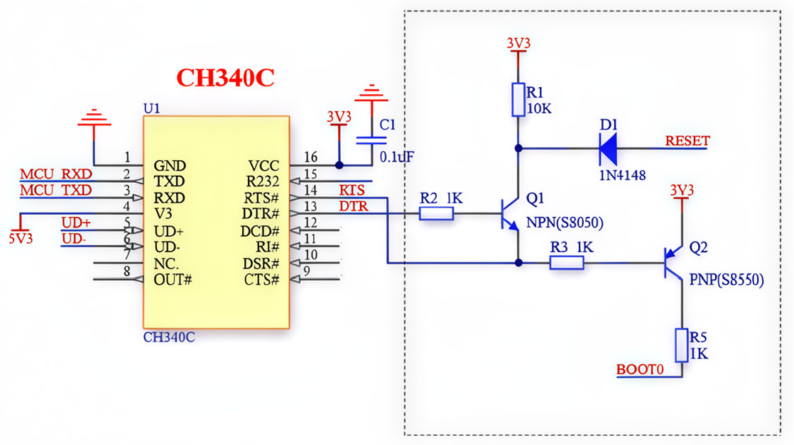
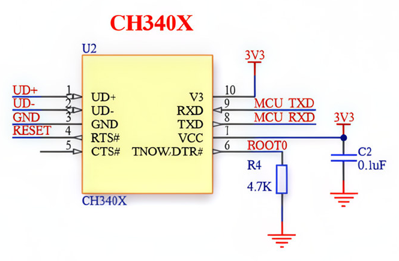

# CH340 硬件与复位时序说明

[English](CH340_HARDWARE.en.md)

本文件说明基于 CH340 系列 USB-UART 桥接芯片的自动下载电路设计、控制线电平约定与复位时序。

0.2.2 预发布 改动已在 CH340C PDM 板上完成部分实机验证，范围见[验证记录](HARDWARE_VALIDATION.md#3-2026-11-08ch340c-pdm-验证)。CH340X、Windows 和 Linux 的本次回归仍待完成。

---

## 1. 硬件连接规范

STM32 通过其系统存储区内置的 ROM USART Bootloader 进行串口烧录。目标板与 USB-UART 模块连接时须满足以下条件：

- **串口信号**：USB-UART 的 TXD 接 STM32 Bootloader USART 的 RX，RXD 接 TX，双方需共地（GND）。
- **逻辑电平**：确认串口模块的 I/O 电平与 STM32 芯片电压（通常为 3.3V）匹配，避免将 5V 或 RS-232 高压电平接入 MCU 引脚。
- **启动与复位引脚**：自动下载电路须通过 DTR/RTS 信号驱动 STM32 的 BOOT0（或相应启动配置引脚）和 NRST。BOOT1（若有）通常接地，启动配置规范以 ST [AN2606](https://www.st.com/resource/en/application_note/an2606-stm32-microcontroller-system-memory-boot-mode-stmicroelectronics.pdf) 为准。
- **接口属性**：板载 USB-C 接口需连接至 USB-UART 桥接芯片及相关启动控制电路。仅连接 STM32 原生 USB 外设的接口无法走 USART ISP 流程。

---

## 2. 软件电平极性约定

项目内部逻辑对 Modem 控制信号统一约定为：
- `true`：**低电平**（Assert / 导通）
- `false`：**高电平**（Deassert / 截止）

> [!NOTE]
> Node.js `serialport` 库原生接口的布尔语义与上述约定相反。适配层 `src/node-serial-transport.js` 统一负责极性取反，配置文件和核心代码中使用统一的高层约定。

0.2.2 预发布：适配层缓存最近一次成功设置的 `dtr`/`rts` 状态。更新任一控制线时，每次向 `port.set()` 传入两条线的完整状态；打开端口后缓存初始化为库默认的 `true/true`。电平取反规则不变，缓存不代表 MCU 引脚的实测电平。这样可避免省略的字段被库恢复为默认值，参见 [SerialPort Stream API 的 set() 说明](https://serialport.io/docs/api-stream/#set)。

---

## 3. CH340C 经典外围电路 (`dtr-low-rts-high`)

该电路通过一对晶体管（NPN + PNP）配合阻容网络，将 DTR 与 RTS 信号转化为 BOOT0 与 NRST 所需的电平：

- **复位控制**：DTR# 经基极限流电阻驱动 NPN 管 Q1，下拉 NRST 产生复位脉冲。
- **启动控制**：RTS# 配合 PNP 管 Q2 控制 BOOT0 电平。
- **状态逻辑**：
  - RTS 同时连接 Q1 的发射极与 Q2 的基极网络，BOOT0 与 NRST 控制相互关联。
  - 进入 Bootloader、复位运行和 GO 准备分别使用完整的控制线组合，不能套用两条线独立控制的通用时序。

*原始电路参考：[WCH-SoftGroup 原文说明](https://www.cnblogs.com/WCH-SoftGroup/p/16520720.html)。*

### 代码时序参数

Bootloader 进入流程（`dtr-low-rts-high`）：

1. 请求 `(DTR, RTS) = (false, true)`，等待 100 ms；
2. 请求 `(true, false)`，等待 100 ms；
3. 请求 `(false, false)`，等待 800 ms；
4. 发送 `0x7F` 同步字节。

以上布尔值是核心代码传给 transport 的请求值，取反仍只在 Node 适配层完成。入口明确写出旧实现的有效组合，不再依赖 SerialPort 对省略字段的默认值。

CH340C 硬件复位运行使用 `(DTR, RTS) = (false, true) → (true, false) → (false, true) → (false, true)`，等待分别为 100、100、200 和 800 ms。最终保持 `(false, true)`；GO 前也请求该组合并等待 100 ms。

通用预设和自定义映射仍按 `boot0Low` 与 `resetAssert` 的反值设置最终运行态。现有等待时间保留；控制线请求值不代表 MCU 引脚的实测电平。

---

## 4. CH340X 直连参考电路 (`ch340x`)

CH340X 具备专用的 Modem 控制特性，可省去外部三极管，直接通过引脚网络连接 MCU：

| CH340X 引脚 | 芯片功能 | MCU 连接目标 | 说明 |
| --- | --- | --- | --- |
| 8 脚 | TXD | MCU RXD | 串口数据发送 |
| 9 脚 | RXD | MCU TXD | 串口数据接收 |
| 4 脚 | RTS# | RESET (NRST) | 复位控制输出 |
| 6 脚 | TNOW / DTR# | BOOT0 | 启动配置控制输出 |
| 6 脚外接 R4 | 4.7 kΩ 下拉 | GND | 配置为增强 DTR 输出并提供 BOOT0 下拉 |

*电路参考：[WCH 官方应用说明](https://www.wch.cn/application/575.html)。*

### 时序状态机
在 `src/core/reset-timing.js` 中，CH340X 的时序定义如下：

- **进入 Bootloader**：
  - 状态依次为：`(RTS, DTR) = (false, true) → (true, true) → (true, false) → (true, true)`
  - 各状态等待依次为 150、150、150 和 1000 ms，随后发送同步字节 `0x7F`。
- **复位运行用户程序**：
  - 0.2.2 预发布修正为 `(RTS, DTR) = (true, false) → (false, false) → (true, false)`。DTR 保持 BOOT0 运行态，RTS 产生复位脉冲并保持释放终态。
  - 各状态等待依次为 250、250 和 1000 ms，目的是释放 NRST 并从 Flash 启动；是否运行须实机观察。

CH340X 进入 Bootloader 的组合及等待时间保留，此前已由用户测试。本次仅调整结束复位与 GO 准备；复位等待仍为 250、250 和 1000 ms，新终态尚待实机回归。

根据上述参考电路和 [WCH 下载说明](https://www.cnblogs.com/WCH-SoftGroup/p/16520720.html)，RTS 接 NRST，增强 DTR 接 BOOT0。旧结束时序固定 RTS、切换 DTR，未按接线对 NRST 产生脉冲；修正后固定 DTR、切换 RTS。以上为控制线请求，仍需实测 MCU 引脚。

---

## 5. GO 前的控制线准备（0.2.2 预发布）

`runMode=go` 调用 `prepareForGo()`，不会复用硬件复位运行时序：

| 复位模式 | GO 前的处理 |
| --- | --- |
| CH340C 经典电路 | 请求 `(DTR, RTS) = (false, true)`，等待 100 ms；DTR 保持入口结束状态，不发复位脉冲 |
| 通用预设、自定义映射 | 同时请求配置的 `boot0Low` 和复位释放态，等待 100 ms，不发复位脉冲 |
| `ch340x` | 请求 `(RTS, DTR) = (true, false)`，等待 250 ms；RTS 保持入口结束状态，只恢复 DTR 运行态，不发复位脉冲 |
| `none` | 保留当前控制线，启动条件由用户管理 |

`ch340x` 下，GO 准备和硬件复位均以 `(RTS, DTR) = (true, false)` 结束。`none` 下，正常启动条件仍由用户管理。GO 使用本次烧录地址，要求该处有有效向量表；ACK 不证明应用已运行，失败也不会自动回退到硬件复位。详见[使用手册](USAGE.md)。

`runAfterWrite=false` 仅跳过运行步骤。`runMode=hardware-reset` 配合 `resetMode=none` 时也不自动运行，日志明确提示需要手动复位。

## 6. 关键调试与排查要点

- **同步字节超时 (`0x7F` Timeout)**：
  - 通常是 MCU 未能成功进入 Bootloader。首先检查供电、共地以及 BOOT0/NRST 引脚接线。
  - 若使用非标准电路，建议先切到 `none` 模式，手动按住开发板 BOOT 键并按 RST 键进行排查。
- **收到持续乱码或用户程序输出**：
  - 说明自动下载电路未能打断用户程序运行，需用示波器或逻辑分析仪测量复位脉冲与 BOOT0 电平保持时间。
- **烧录完成后板卡不运行**：
  - 检查运行方式、GO 地址与向量表，并测量 BOOT0/NRST。插件默认开启 `closePortAfterWrite`，但端口关闭后的电平取决于驱动、桥接芯片和板上电路，不能保证释放复位、启动应用或阻止跳转。即使使用 `none` 或跳过运行，开关端口也可能影响引脚。按[硬件验证模板](HARDWARE_VALIDATION.md) 做关闭串口 A/B 对照。
- **全片擦除长等待**：
  - 大容量 STM32（如 High-density / XL-density）全片擦除耗时可能达到数十秒。协议层为此设置了 60 秒的专用超时窗口。
