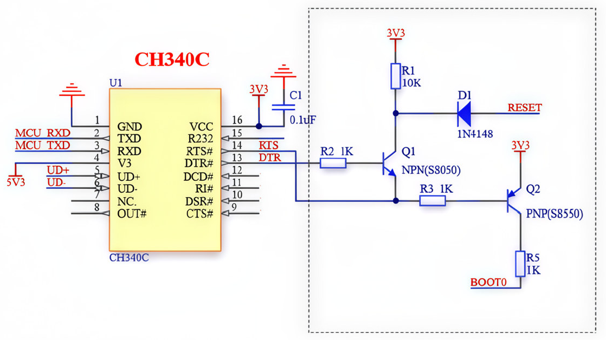
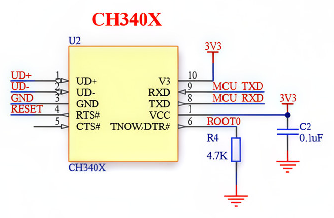

# CH340 DTR/RTS 硬件说明

## 连接条件与预设选择

SerialFlash 使用 STM32 ROM USART Bootloader 烧录。目标 MCU 必须支持该启动方式，并连接到 ROM Bootloader 支持的 USART 和引脚。应用固件中能用的串口，不一定能用于 ROM 下载。具体型号的接口、引脚、BOOT 条件和选项字节要求，见 ST [AN2606](https://www.st.com/resource/en/application_note/an2606-stm32-microcontroller-system-memory-boot-mode-stmicroelectronics.pdf)。

连接前确认以下条件：

- USB 转串口 TXD 接 MCU RX，RXD 接 MCU TX，双方共地。
- 串口逻辑电压与 MCU 引脚匹配。确认模块的 I/O 电压，供电端标注不能代替逻辑电平检查；RS-232 电平不能直接连接 MCU。
- 自动下载需要按板上电路连接 DTR/RTS、BOOT0（或对应启动选择引脚）和 NRST。BOOT 上下拉、BOOT1 和选项字节按具体 MCU 要求设置。
- 目标板有稳定供电。使用外部串口模块时，先确认板卡的供电方式，再连接模块电源。
- 板上只有 USB-C 接口还不够：该接口必须连接到可用的 USB 转串口电路，并具备所需的 USART 和启动控制连接。仅供电或接 MCU 原生 USB 的接口，不能据此认定支持本插件。

**按板上接线和有效极性选择预设，不能只看 CH340C/CH340X 型号。** 同一芯片可用于不同拓扑。没有自动控制线时，选择 `none`，按 MCU 手册手动设置 BOOT 并复位进入 ROM Bootloader。

## 电路图来源与使用范围

可核对原图的说明文章是 WCH-SoftGroup 的[《免外围电路 CH32F/CH32V/STM32F 系列单片机串口一键下载方案（CH340）》](https://www.cnblogs.com/WCH-SoftGroup/p/16520720.html)。文章概述中的第一张对比图包含下方 CH340C 和 CH340X 电路。WCH 官网另有[《免外围电路的单片机串口一键下载方案》](https://www.wch.cn/application/575.html)，芯片引脚与增强 DTR 配置见 [CH340 产品页](https://www.wch.cn/products/CH340.html)和 [CH340DS1 技术手册](https://www.wch.cn/downloads/CH340DS1_PDF.html)。


仓库保留两张原图。下方 PNG 只裁掉标题和外部留白，未重画或修改引脚、网络名、元件值和连线。它们是局部电路参考，不是完整 PCB 设计。USB 接口、供电、保护和 MCU 启动电路仍需按实际板卡核对；图中原有标注也应以芯片手册和实际原理图为准。

## 电平约定

项目内部统一约定：

- `true`：低电平。
- `false`：高电平。

Node `serialport` 的 modem 线布尔值语义相反，因此 `src/node-serial-transport.js` 内部会对 DTR/RTS 取反。软件控制值不能直接当作增强 DTR 引脚的实测电压；该引脚的输出方式还取决于芯片配置。

## 经典 CH340C 电路

下图的 CH340C 外围加入三极管电路：

- DTR# 经 R2 控制 Q1（NPN），参与 RESET 控制。
- RTS# 接入 Q1 发射极和 R3，配合 Q2（PNP）控制 BOOT0。
- DTR 和 RTS 同电平时，三极管通常截止，引脚由板载上下拉决定。
- DTR 和 RTS 一高一低时，电路会主动驱动 RESET 或 BOOT0。



[查看未裁剪原图](assets/circuit_of_ch340c.png)。图文出处见上方来源说明。

### 历史 CLI 验证

2026-06-01 的历史记录（提交 `7b854bf`）确认过以下入口序列：

1. RTS 低电平。
2. DTR 低电平。
3. DTR 高电平。
4. 等待约 800 ms。
5. 发送 STM32 同步字节 `0x7F`。

等价的 `stm32flash` 验证命令：

```bash
stm32flash -b 115200 -i -rts,-dtr,dtr /dev/tty.usbserial-10
```

验证对象与结果：

- CH340C 经典电路。
- STM32F10xxx Medium-density。
- Bootloader `0x22`。
- PID `0x0410`。
- 历史 CLI 烧录、擦除和校验完成；当前插件分支不再保留 CLI 入口。

这条记录不代表当前 VS Code 插件已完成同板实机回归。

## CH340X 直连参考电路

下图直接连接 modem 输出，具体接线为：

| CH340X 引脚 | 参考图连接 |
| --- | --- |
| TXD，8 脚 | MCU RXD |
| RXD，9 脚 | MCU TXD |
| RTS#，4 脚 | RESET（MCU NRST） |
| TNOW/DTR#，6 脚 | BOOT0；原图网络名印作 `ROOT0`，裁剪图保留原标注 |
| 6 脚外接 R4 | 4.7 kΩ 下拉到 GND，用于增强 DTR 配置和 BOOT 下拉 |



[查看未裁剪原图](assets/circuit_of_ch340x.png)。接线和增强 DTR 配置可对照 [WCH 官方方案第 3.1 节](https://www.wch.cn/application/575.html)。

参考图使用 RTS# 控制 RESET、增强 DTR 控制 BOOT0。历史 Web 说明及下面 CLI 记录将软件控制项描述为“RTS BOOT / DTR RESET”，两者不能直接视为相同接线。本次保留历史记录和当前预设；新板接入前需核对实际控制线映射和引脚电平。

### 历史 CLI 实测时序

2026-06-05 使用 CAN2RS485 板实测（提交 `99dba17`），历史记录将 `ch340x` 预设入口描述为：

1. RTS 运行态，DTR 释放 RESET。
2. RTS 进入 Bootloader 条件，DTR 保持释放。
3. RTS 保持 Bootloader 条件，DTR 触发 RESET。
4. RTS 保持 Bootloader 条件，DTR 释放 RESET。
5. 等待约 1000 ms 后发送 STM32 同步字节 `0x7F`。

退出运行时序的历史描述：

1. RTS 退出 Bootloader 条件，DTR 保持运行复位初态。
2. RTS 保持运行态，DTR 切换到相反电平触发 RESET。
3. RTS 保持运行态，DTR 回到初态，释放 RESET 运行用户程序。

当前 `src/core/reset-timing.js` 保留的入口控制值依次为 `(RTS, DTR) = (false, true) → (true, true) → (true, false) → (true, true)`。退出控制值依次为 `(false, false) → (false, true) → (false, false)`。这些是项目内部布尔值，Node 适配层仍负责取反，不是本次测得的引脚波形。

验证对象与结果：

- CH340X 直连电路 CAN2RS485 板。
- macOS 端口 `/dev/tty.usbserial-10`。
- 固件 `/Users/poli/STM32CubeIDE/workspace_2.1.1/CAN2RS485/build/Debug/CAN2RS485.hex`。
- Bootloader `0x31`。
- PID `0x0413`。
- 历史 CLI 确认有效入口组合 `RTS BOOT=true / DTR RESET=false`。
- 擦除、写入、读回校验完成。

这条记录只覆盖当时的 CLI、板卡和环境。当前 VS Code 插件的自动入口、烧录后运行和串口释放仍需按[硬件验证模板](HARDWARE_VALIDATION.md)补做实机验证。本次文档和裁剪图片更新没有连接硬件，也没有新增实测结论。

## 调试经验

- `0x7F` 同步超时通常是没有进入 ROM Bootloader，应先核对启动条件和接线。
- 收到持续乱码或 `0x43` 一类字节，通常是用户程序或其他 Bootloader 在输出。
- Node `serialport` 的 DTR/RTS 布尔语义与项目内部电平约定相反，适配层必须统一取反。
- CH340X 板烧写后若端口保持打开，DTR/RTS 可能继续影响运行；插件默认完成后关闭串口。
- 较大容量 STM32 的全片擦除可能超过 15 秒，当前 ACK 等待为 60 秒。

## 排查清单

- 使用 `115200 8E1`。
- macOS 自动复位优先使用 `/dev/tty.usbserial-*`。
- 如果持续读到用户程序输出，检查是否进入 ROM Bootloader。
- 如果 Sync 成功但 GET 超时，先检查 STM32 响应解析。
- 新板型改预设前，先核对原理图，并用 `stm32flash` 或只读命令验证。
